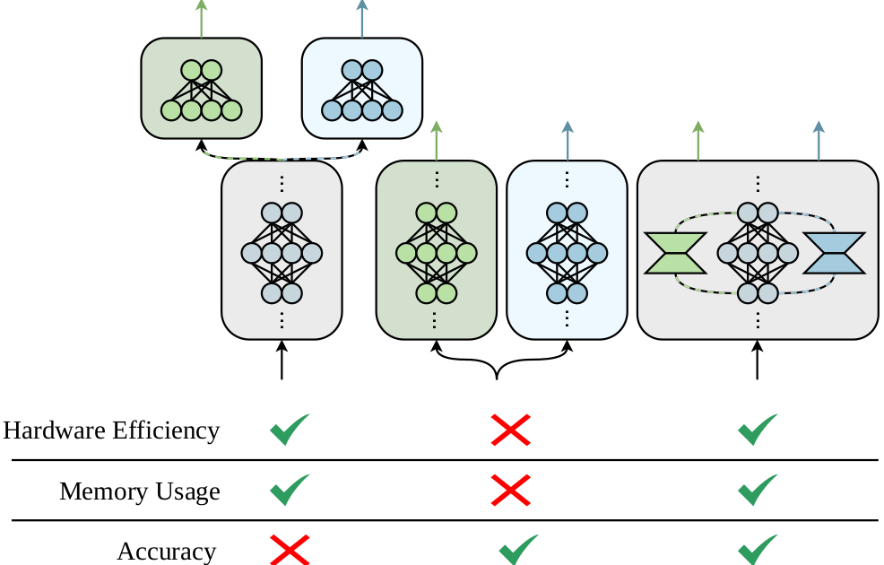
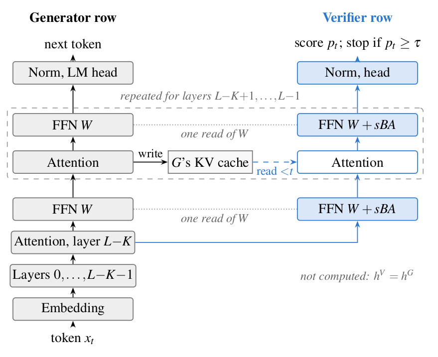

# ToRA: Near-Free Streaming Safety Checks for Local LLMs

Code for the paper **"Run One, Get Two: Near-Free Streaming Safety Checks for Local LLMs"**
by Soheil Zibakhsh, Pedram Aghazadeh, and Farinaz Koushanfar (University of California San Diego).

[Paper (arXiv)](https://arxiv.org/abs/XXXX.XXXXX) · [Reproducing the paper](REPRODUCE.md)

<p align="center"></p>

## Overview

A local LLM assistant decodes for one user at a time, so every decode step is bound by the time it takes to stream the
model's weights from memory, and most of the GPU's compute sits idle. Today's streaming safety checks force a choice
between two poor uses of that budget: a dedicated guard model is accurate but nearly doubles the latency per token,
while a probe on the generator's hidden states is cheap but noticeably less accurate.

**ToRA** (Tandem of low-Rank Adapters) spends the idle compute on a second model that costs almost nothing to run. The
verifier is the generator itself, with low-rank adapters on the FFNs of its top *K* layers and a small classification
head. It runs as a second row in the generator's own decode step, so both rows are served by a single pass over the
weights, and instead of keeping a KV cache of its own it attends to the cache the generator already writes. Custom
dual-row Triton kernels apply the adapter inside the weight pass, which keeps the verifier's added memory traffic
below 1% of the generator's. Training labels earlier positions of each response from a token-level teacher's unsafe
onsets, so the verifier learns to raise its score as soon as unsafe content begins rather than only at the end.

<p align="center"></p>

## Results

On Qwen3-0.6B (one RTX A6000, batch 1), ToRA has a higher F1 than Qwen3Guard-Stream on 12 of the 17 benchmarks
while adding under 4% latency per token over the generator, and it detects 11.8 points more unsafe responses than
SingProbe at a similar cost. All of ToRA's numbers below are measured through the deployed decode step (compiled,
CUDA-graph-captured fused kernels) and are the mean ± std over 3 seeds.

| Method | Response F1 (8) | Prompt F1 (9) | Detected @5% | Delay @5% | Detected @1% | ms / token at 2k | Added latency at 512 / 2k / 8k | Added memory at 8k |
|---|---|---|---|---|---|---|---|---|
| Qwen3Guard-Stream | 80.4 | 84.6 | **84.7** | 7 | **61.0** | 5.527 | +84.3 / +85.9 / +89.3% | 1,139 + 910 MiB |
| SingProbe | 77.6 | 83.0 | 71.8 | 7 | 48.5 | **3.022** | **+1.7 / +1.6 / +1.2%** | **4.3 + 2.0 MiB** |
| **ToRA (ours)** | **81.4** ± 0.2 | **86.3** ± 0.4 | 83.6 ± 0.6 | **5.0** | 59.5 ± 1.6 | 3.078 | +4.0 / +3.5 / +2.8% | 9.3 + 0 MiB |

F1 is the unsafe-class F1 averaged over each task's benchmarks. Streaming detection is measured on the 813 unsafe
responses of Qwen3GuardTest at thresholds that flag at most 5% or 1% of safe validation responses, and the delay is
the median number of tokens between the start of the unsafe span and the first flag. Each method's latency is
measured on the same generator kernels and the memory column gives weights + caches. See the paper for the
per-benchmark tables and the ablations.

## Repository layout

```
src/tora/
  models/      qwen3_min.py (a minimal Qwen3 that matches HF bit for bit), verifier.py (ToRA and the own-KV ablation),
               lora_ffn.py, heads.py, probes.py (frozen-feature control), baselines/ (Qwen3Guard-Stream, SingProbe)
  kernels/     dual_lora.py (Triton dual-row kernels), reference.py (PyTorch references), ops.py (custom ops)
  inference/   decode_ref.py (reference dual-row decoder), decode_static.py (static, compiled, CUDA-graph decode step),
               decode_baselines.py (the baselines' decode steps for the latency comparison)
  train/       train_verifier.py (ToRA's trainer and its ablations), evaluation.py
  eval/        run_eval.py (benchmarks and streaming metrics), scorers.py, checkpoint_scorer.py (teacher-forced),
               fused_scorer.py (the deployed decode step), metrics.py, generate.py
  data/        loaders.py (one loader per benchmark), prepare.py (splits, leakage removal, data checks), formatting.py
  bench/       timing.py, cost_model.py (analytic FLOPs and bytes)
configs/       model/, data/ (one file per dataset), prepare.yaml, train/tora.yaml, eval/
scripts/       train.sh (every training run of the paper), teacher_onsets.py, stream_eval.sh, deployed_eval.py,
               f1_table.py, stream_table.py, headline_table.py, stream_diag.py, decode_bench.py, layer_bench.py,
               cost_table.py
tests/         unit and GPU tests: kernels against references, decode paths against each other, HF parity
```

## Installation

The code was developed and tested on Linux with one NVIDIA RTX A6000 (48 GB), CUDA 12.2 drivers, and Python 3.11.
The dual-row kernels need Triton and a CUDA GPU, and the training micro-batches are sized for a 48 GB GPU.

```bash
conda env create -f environment.yml     # pins the versions of the paper's runs
conda activate tora
pip install -e ".[dev]"
export HF_TOKEN=...                     # a Hugging Face token whose account has accepted the gated datasets' terms
```

Check the installation with the CPU tests, then the GPU tests (`CUDA_VISIBLE_DEVICES` must name a free GPU):

```bash
python -m pytest -m "not gpu"
CUDA_VISIBLE_DEVICES=0 python -m pytest -m "not slow"    # about 10 minutes
```

## Quick start

This repository does not include datasets or checkpoints. The commands below prepare the data, train one ToRA model
and score every benchmark through the deployed decode step; [REPRODUCE.md](REPRODUCE.md) covers the baselines, all
three seeds, the latency benchmarks and every ablation, with the expected numbers.

```bash
python -m tora.data.prepare                                    # download and split the 16 datasets -> data_cache/
for i in 0 1 2 3; do CUDA_VISIBLE_DEVICES=$i python scripts/teacher_onsets.py --shard $i --num-shards 4 & done; wait
CUDA_VISIBLE_DEVICES=0 bash scripts/train.sh tora 0            # about 72 minutes -> results/train/tora_seed0-<id>/tora.pt
RUN=deployed_seed0-$(date +%Y%m%d-%H%M%S)
for i in 0 1 2 3; do CUDA_VISIBLE_DEVICES=$i python scripts/deployed_eval.py score --run-id $RUN --shard $i --shards 4 \
    --method tora_s0 --ckpt "results/train/tora_seed0-*/tora.pt" & done; wait
python scripts/deployed_eval.py metrics --run-id $RUN --method tora_s0
```

To use a trained verifier while generating, `tora.inference.decode_static.StaticDecoder` runs the generator and the
verifier row as one decode step (mode `fused` uses the dual-row kernels), and `tora.eval.fused_scorer` shows how to
load a checkpoint into it.

## Citation

```bibtex
@article{zibakhsh2026tora,
  title   = {Run One, Get Two: Near-Free Streaming Safety Checks for Local {LLMs}},
  author  = {Zibakhsh, Soheil and Aghazadeh, Pedram and Koushanfar, Farinaz},
  journal = {arXiv preprint arXiv:XXXX.XXXXX},
  year    = {2026}
}
```

## License

The code is released under the [MIT License](LICENSE). The datasets and models it downloads keep their own licenses
and terms of use.
